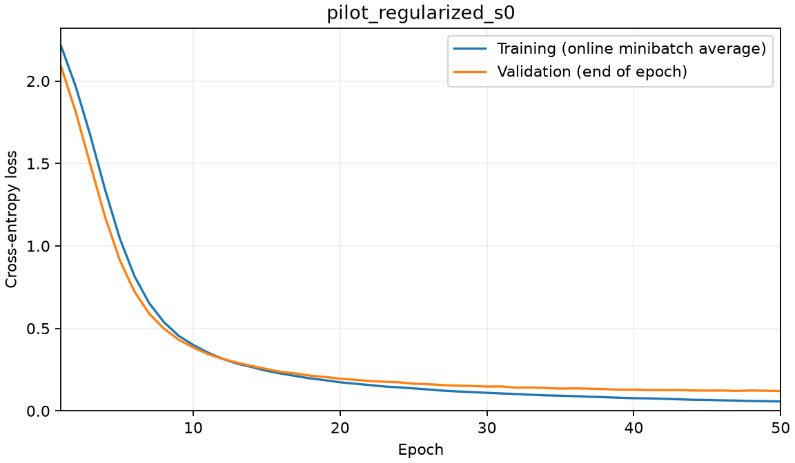

# eureka-digits-sol

This project tests whether AdamW weight decay changes a small digit classifier's held-out accuracy. It combines a fixed training protocol with saved predictions, checkpoint audits, negative controls, a simple linear baseline and an interactive evidence explorer. The implementation uses [scikit-learn digits](https://scikit-learn.org/stable/modules/generated/sklearn.datasets.load_digits.html) and [PyTorch AdamW](https://docs.pytorch.org/docs/2.14/generated/torch.optim.AdamW.html).

The observed primary accuracy contrast tied, so the registered conditional analysis is inconclusive. Prior Haiku and Luna outcomes were already known: this is an **exploratory engineering replication**, with no untouched-data confirmation or agent ranking. See the [final report](cycles/001/reports/final.md), [paper](site/paper.pdf), [interpretation](cycles/001/reports/interpretation.md) and [review](cycles/001/reports/review.md) for evidence and limits.

The workflow records predictions and alternatives, preserves failures, and distills a few supported claims following [Neel Nanda's research-process guidance](https://www.alignmentforum.org/s/5GT3yoYM9gRmMEKqL). The controller owns publication; presentation repairs reuse valid measurements.

The supplied implementation uses a fixed MLP with AdamW, a zero-decay ablation, a smaller-decay sensitivity arm, shuffled-label control, logistic baseline and majority-class baseline. Source research is in [the literature review](cycles/001/reports/research.md); all scientific settings and interpretation rules are in [the prospective exploratory plan](cycles/001/reports/preregistration.md).

Core provides non-training regression checks and a wrapper that preserves complete timestamped console logs. The [pilot](cycles/001/reports/pilot.md) and all registered comparisons now have saved predictions and independently checked checkpoints. The [comparison report](cycles/001/reports/experiments.md) contains generated scores, full neural loss histories, shared output examples and limitations. Primary paired test correctness tied despite changed fitted weights; the inherited conditional analysis is inconclusive. Real-label arms exceeded the negative controls, and logistic regression was descriptively competitive. No positive decay benefit was observed. The project uses Python, NumPy, scikit-learn, PyTorch, safetensors, Matplotlib and standard-library tests; dependency versions are in [pyproject.toml](pyproject.toml).

The [local evidence explorer](site/index.html) filters saved results and displays losses and examples; serve the repository over HTTP to load its JSON data. Its script logic passed scoped checks, but browser visual inspection and deployed-page behavior remain unverified. The paper was visually inspected during review. Publication and any refresh of the generated status snapshot below belong to the controller.

Follow [docs/reproduction.md](cycles/001/docs/reproduction.md) for installation, the supplied interpreter, checks, method definitions, artifact locations and later phase commands. The controller owns commits and publication. The pilot must be published before comparative training. Prior-result exposure and the random example split limit this execution to exploratory conclusions.

<!-- EUREKA:RESULTS:START -->
## Recorded results

Recorded harness status: **complete**; 8 operational phases accepted. Measurements below do not imply completion of unaccepted phases.

| Experiment | Method | Seed | Split | Accuracy | Seconds | Device |
|---|---|---:|---|---:|---:|---|
| class_prior_s0 | class_prior | 0 | test | 0.102778 | 0.027 | cpu |
| logistic_s0 | logistic | 0 | test | 0.955556 | 0.109 | cpu |
| pilot_regularized_s0 | regularized | 0 | validation | 0.966574 | 6.083 | cuda |
| regularized_s0 | regularized | 0 | test | 0.963889 | 0.373 | cuda |
| regularized_s1 | regularized | 1 | test | 0.969444 | 5.740 | cuda |
| regularized_s2 | regularized | 2 | test | 0.969444 | 2.151 | cuda |
| sensitivity_s0 | sensitivity | 0 | test | 0.963889 | 2.098 | cuda |
| sensitivity_s1 | sensitivity | 1 | test | 0.969444 | 2.105 | cuda |
| sensitivity_s2 | sensitivity | 2 | test | 0.969444 | 2.121 | cuda |
| shuffled_labels_s0 | shuffled_labels | 0 | test | 0.061111 | 2.190 | cuda |
| shuffled_labels_s1 | shuffled_labels | 1 | test | 0.116667 | 2.194 | cuda |
| shuffled_labels_s2 | shuffled_labels | 2 | test | 0.108333 | 2.103 | cuda |
| unregularized_s0 | unregularized | 0 | test | 0.963889 | 2.032 | cuda |
| unregularized_s1 | unregularized | 1 | test | 0.969444 | 2.142 | cuda |
| unregularized_s2 | unregularized | 2 | test | 0.969444 | 2.203 | cuda |

The mean paired accuracy difference is 0.000000, with conditional 95% bootstrap interval [0.000000, 0.000000]. The registered decision is **inconclusive**. The sample standard deviation across seed effects is 0.000000. The interval uses 10000 paired resamples of test examples and conditions on the trained models.

See [full report](cycles/001/reports/summary.md).
<!-- EUREKA:RESULTS:END -->
