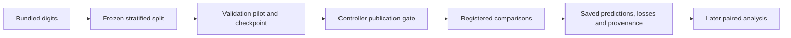

# eureka-digits-sol

Execute the supplied digits study as an exploratory engineering replication. Prior Haiku and Luna results are already known, so this run cannot establish new preregistered confirmation on untouched data. Preserve the supplied scientific definitions and exploratory classification. Do actual source research, editing, checks, training, pilot publication, comparisons, interpretation and review.

The engineering objective is verified completion with reproducible artifacts, whether the scientific effect is positive, negative or inconclusive. Use the selected model only. The controller publishes and accounts for all inference. Reuse valid measurements on repairs; do not rerun training to fix formatting. Use the supplied draft verification command to check artifacts before returning. Prefer a few precise, supported claims over an extensive ledger of redundant assertions. Refer to experiment and source IDs directly; only additional local audits need artifact-ledger entries.

Record predictions and alternative explanations before experiments and compare them to observations afterward. Follow Neel Nanda's exploration, understanding and distillation guidance: https://www.alignmentforum.org/s/5GT3yoYM9gRmMEKqL . Preserve failures and limitations. This trial demonstrates one execution, not model superiority or general scientific reliability.

The supplied implementation uses a fixed MLP with AdamW, a zero-decay ablation, a smaller-decay sensitivity arm, shuffled-label control, logistic baseline and majority-class baseline. Source research is in [the literature review](cycles/001/reports/research.md); all scientific settings and interpretation rules are in [the prospective exploratory plan](cycles/001/reports/preregistration.md).

Core provides non-training regression checks and a wrapper that preserves complete timestamped console logs. No local model training or predictive results have been produced yet. The project uses Python, NumPy, scikit-learn, PyTorch, safetensors and standard-library tests; dependency versions are in [pyproject.toml](pyproject.toml).

Follow [docs/reproduction.md](cycles/001/docs/reproduction.md) for installation, the supplied interpreter, checks, method definitions, artifact locations and later phase commands. The controller owns commits and publication. The pilot must be published before comparative training. Prior-result exposure and the random example split limit this execution to exploratory conclusions.
