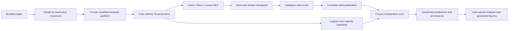

# Reproducing the fixed digits study

The [review report](../reports/review.md) records the final scoped code, science, citation, reproduction and presentation review. After controller regeneration, run `& $digitsPython reports/repair_presentation.py` from the cycle directory to reapply portable paper links, the protocol-derived settings supplement and website example attribution. This uses installed Pandoc and pdfLaTeX and never fits models or changes measurements. Then run `& $digitsPython reports/audit_review.py` and `node reports/test_site.cjs` for the documented non-fitting checks. The Node test uses a minimal DOM adapter; it is not a browser or visual layout test.

This is an **exploratory engineering replication** of a supplied study, not new confirmation on untouched data. Prior outcomes are known. The question is whether the registered AdamW decay intervention changes accuracy in this fixed setting. Source research and prior-run disclosures are in [research.md](../reports/research.md); the prospective interpretation rules are in [preregistration.md](../reports/preregistration.md). Training, comparisons, analysis and review have local artifacts; the [final report](../reports/final.md) reconciles their outcomes and residual limits. Final publication and phase acceptance remain controller-owned.

## Code and scientific contract

The supplied [study.py](../study.py) implements data construction, network construction, fitting, checkpoint reload verification, scoring and the phase gate as separate functions. It remains byte-identical to `audit-fixture-source` in [evidence.json](../research/evidence.json). The registered [protocol.json](../research/protocol.json) is authoritative for all hyperparameters, seeds and analysis definitions; [registration.json](../research/registration.json) binds its bytes. Do not reformat either scientific file after registration or after measurements.

The added [run_study.py](../run_study.py) prepares output directories and streams the fixture's complete textual stdout/stderr to both the terminal and a new UTC-named log. It calls the same interpreter without a shell and preserves the child exit code. It changes no fitting or scoring rule. Python text mode normalizes line endings. [src-python-subprocess](https://docs.python.org/3.14/library/subprocess.html).



Checkpoint reload verification forwards all feature rows, including test inputs. Pilot **scoring** uses validation labels only. Validation losses are diagnostic; the final fixed epoch supplies the checkpoint. The inspected architecture has no batch normalization or dropout. Do not describe the pilot as excluding all test-feature access. `audit-fixture-source`; [src-haiku-disclosure](https://github.com/BurnyCoder/eureka-digits-haiku/blob/main/reports/post-run-publication.md).

## Environment

The harness supplies this research interpreter:

```powershell
$digitsPython = 'C:/Users/Happy/Documents/projects/auto-eureka-scientist-agent-harness/.venv/Scripts/python.exe'
Set-Location 'C:/Users/Happy/Documents/projects/auto-eureka-scientist-agent-harness/workspaces/eureka-digits-sol/cycles/001'
```

For a separate checkout, install `uv`, run `uv sync --locked --python 3.14` at the repository root, and use that checkout's `.venv` interpreter. For the configured CUDA wheel index use `uv sync --locked --python 3.14 --extra cuda` instead. The root [pyproject.toml](../../../pyproject.toml) pins the research packages and [uv.lock](../../../uv.lock) records dependency resolution. The pilot uses the harness-provided interpreter; its actual installed package versions are recorded in the pilot audit rather than inferred from the lockfile. No credentials, downloads from a private service, or `.env` values are required by the fixture. Do not run `uv init` over this existing project.

The observed interpreter, package versions and device availability are machine-generated in [core-checks.json](../research/core-checks.json). Those are environment checks, not measurements of GPU training performance. The fixture selects CUDA when available and otherwise CPU; it sets RNG seeds and deterministic algorithms. Exact cross-release or cross-platform reproducibility is not guaranteed. [src-reproducibility](https://docs.pytorch.org/docs/2.14/notes/randomness.html).

## Core checks: safe before publication

From the cycle directory, run:

```powershell
& $digitsPython study.py check
& $digitsPython -m unittest discover -s tests -v
& $digitsPython run_study.py check
```

The first command is the controller's canonical rerunnable check, recorded as an argv array with `cwd: cycle` in [checks.json](../research/checks.json). The wrapper check also creates `models/`, `results/` and `reports/logs/` for a fresh checkout. If calling the fixture directly in a fresh checkout, create these directories first; its checkpoint serializer expects `models/` to exist. Preserve model files as controller-managed artifacts because root `.gitignore` excludes model directories.

The [tests](../tests/test_study.py) verify real bundled-data coverage, unique/disjoint split membership, repeatable indices, class presence, fixed-constant pixel scaling, registered hashes, invalid input-width rejection and an untrained safetensors round trip on synthetic features. Temporary-root mocks verify validation-only score construction, stale provenance refusal, cached-record reuse without fitting and the publication gate. [Logging tests](../tests/test_runner.py) exercise actual child processes with long output, stderr, paths containing spaces and unsuccessful exit codes. Test discovery uses the standard library. [src-python-unittest](https://docs.python.org/3.14/library/unittest.html).

No test runs an optimizer step or fits a baseline. Synthetic mock records live only in temporary directories and are not study experiments. Passing these checks cannot validate training dynamics, later checkpoint reuse, trained-model accuracy, statistical power or all leakage classes. The initial expected missing-wrapper failure and subsequent actual results are preserved in [core-checks.json](../research/core-checks.json); the predictions precede testing in [core-plan.md](../research/core-plan.md). The [core report](../reports/core.md) compares predictions with observations and records the implementation review.

## Training reproduction order and controller boundaries

These commands describe the completed training phases' reproduction order. Do not rerun fitting to repair documentation; reuse valid saved measurements:

```powershell
# Pilot phase, after the controller publishes core:
& $digitsPython run_study.py pilot
# STOP here until the controller publishes the pilot and checkpoint.
# Experiments phase, after the controller creates research/pilot-publication.json:
& $digitsPython run_study.py experiments
```

These wrappers delegate to `study.py pilot` and `study.py experiments`. Never create a publication marker manually. The controller owns Git operations, publication, model uploads, inference logs and state. The pilot trains only the registered regularized initial seed and saves its validation result. Comparisons reuse that pilot checkpoint for the matching regularized seed rather than fitting it again. Existing result files are reused when their protocol and fixture code hashes match; the fixture rejects stale hashes. Its cache path does not independently revalidate all saved checkpoint bytes, so later artifact review must check checkpoint hashes and saved predictions. Keep failures and negative results; do not refit to repair a report or path.

## Registered methods and interpretation

| Method key | Role and behavior |
| --- | --- |
| `regularized` | Primary AdamW decay intervention; shared fixed MLP and training schedule |
| `unregularized` | Primary decay ablation: same AdamW and matched seed/order, zero decay |
| `sensitivity` | Smaller registered decay coefficient; descriptive local sensitivity, never test-selected tuning |
| `shuffled_labels` | Negative control: permute training labels, preserving their counts; same MLP and primary decay |
| `logistic` | Regularized linear classifier fitted on training data; simple baseline, not the neural ablation |
| `class_prior` | Constant training-majority predictor; deterministic floor, not random sampling |

Exact architecture, decay coefficients, training budget, seed set and logistic settings are in the [registered method table](../reports/preregistration.md#fixed-methods-seeds-and-hyperparameter-rationale). All neural parameters, including biases, receive decay. This is a weight-decay ablation within AdamW, not an optimizer-versus-optimizer result or an L2-penalty experiment. [src-adamw-paper](https://arxiv.org/abs/1711.05101), [src-torch-adamw](https://docs.pytorch.org/docs/2.14/generated/torch.optim.AdamW.html), [src-logistic](https://scikit-learn.org/stable/modules/generated/sklearn.linear_model.LogisticRegression.html).

Data come from the scikit-learn bundled UCI digits subset, not MNIST. Normalization uses a known constant without fitted statistics. The frozen split is stratified by class and randomized by example; it cannot establish new-writer generalization. Label permutation applies only to training labels. [src-digits-loader](https://scikit-learn.org/stable/modules/generated/sklearn.datasets.load_digits.html), [src-splits](https://scikit-learn.org/stable/modules/generated/sklearn.model_selection.train_test_split.html), [src-uci-digits](https://archive.ics.uci.edu/dataset/80/optical+recognition+of+handwritten+digits).

The primary comparison averages paired test-accuracy differences across the registered seeds. Analysis uses matched example-bootstrap indices shared across both methods and every fitted seed, the registered RNG and resample count, and central percentile endpoints. This interval conditions on the fitted models; seed variation is reported separately. A zero-spanning interval is inconclusive, including a degenerate zero interval. A wholly negative interval contradicts the directional benefit prediction. The initial validation result is documented in [pilot.md](../reports/pilot.md); all comparisons and their primary interval are now in [experiments.md](../reports/experiments.md). The fixture emits raw results; `reports/compare_artifacts.py` implements the paired statistic. [src-bootstrap](https://docs.scipy.org/doc/scipy/reference/generated/scipy.stats.bootstrap.html); [preregistered analysis](../reports/preregistration.md#primary-metric-analysis-plan-and-falsification).

Regenerate the pilot table and loss plot, and rerun its validation-only artifact audit without fitting, using `reports/build_pilot.py` with the supplied interpreter from the cycle directory. The first audit remains preserved in `research/pilot-audit.json`. This script does not run comparisons or test scoring.

Regenerate comparison tables, all-seed loss plots, accuracy points and shared prediction examples using `reports/build_experiments.py` from the cycle directory with the same interpreter. This audits every registered result and checkpoint without fitting and preserves its first audit in `research/experiments-audit.json`. All empirical values in the comparison tables come from saved measurements; the generated `reports/comparison-summary.json` is an aggregate, not another experiment.

## Artifact map and validity review

| Path | Contents and review purpose |
| --- | --- |
| `research/core-checks.json` | Additional local engineering audit, command outputs, environment and frozen-file hashes; not an experiment |
| `reports/logs/` | Wrapper console logs with command, UTC boundaries, complete child text and exit status |
| `results/*.json` | Later experiment records: IDs, method/seed/split, true/predicted labels, example/split IDs, accuracy, loss histories and provenance |
| `models/*.safetensors` | Later neural state dictionaries; verify reload flag and saved SHA against actual bytes |
| `models/*.npz` | Later baseline coefficients or class frequencies, with fixture reload verification |
| `research/sources.json` | Source IDs used here; added code reuses installed APIs and copies no external implementation |

Before interpreting later results, recompute accuracies, align test labels and IDs, verify split coverage and hashes, and confirm every registered method/seed is present. Inspect convergence warnings and anomalous controls. Preserve the pilot's validation label and its distinction from later test scoring. Generate score tables and figures from saved files in the later analysis phase; never hand-enter empirical scores or count aggregates as experiments. The [research review](../reports/research.md) records source licensing and the distinction between example isolation and writer isolation. The present audit is scoped engineering evidence only.

## Publication handoff and non-fitting checks

The controller's `eureka render` regenerates its result-derived tables, figures, summary, paper and site; the controller also handles model cards, commits, Pages deployment and model uploads. The current shared renderer preserves example provenance and the reproduction-guide link. To rebuild this project's additional pilot, comparison and final numerical tables and its presentation in one command, install the harness environment and run the following from the harness checkout:

```powershell
uv run --extra research --extra cuda python PATH/TO/eureka-digits-sol/regenerate.py
```

The wrapper calls the existing builders, verifies saved checkpoints without fitting, renders the shared artifacts and reapplies the project's presentation postprocessor. Replace the path with this clone's actual location. Pandoc and pdfLaTeX must be available. This does not rerun a coding model or rewrite historical audit receipts. Local artifact completeness does not establish successful remote publication; later public checks are documented in [the parent review](../../../reports/parent-review.md).

From the cycle directory, `& $digitsPython reports/audit_publish.py` regenerates the final report's numerical table directly from saved results and checks the protected review hashes, registered summary, claim/source references, requirement paths and local publication links without fitting. It preserves its first audit. The [final report](../reports/final.md) distinguishes these local observations from pending controller actions and browser/deployment checks.
