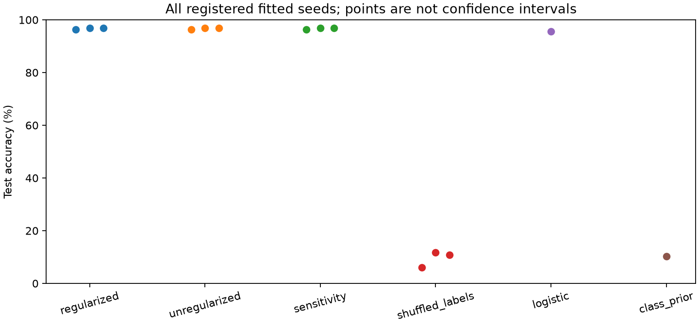
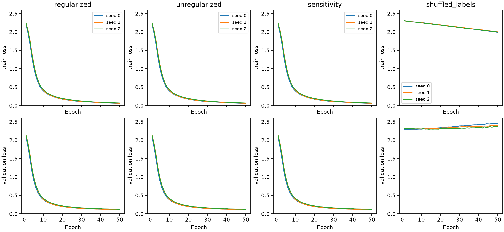
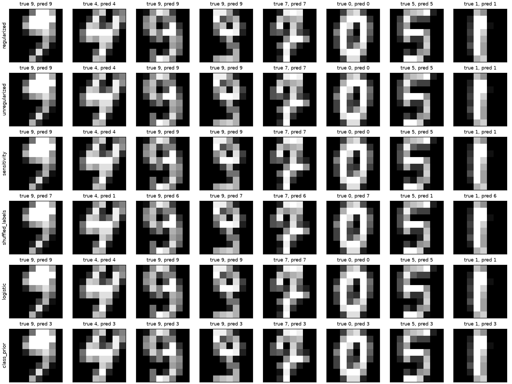

# Frozen comparisons, controls and sensitivity

Author: Libor “Burny” Burian. Stage: exploration. Analysis kind: **exploratory**. This is a fixed-fixture engineering replication with prior Haiku and Luna outcomes already known. Prospective local planning does not establish new confirmation on untouched data. The controller owns publication; this report records local execution only.

## Objective and selection rationale

The project goal is verified reproducible completion regardless of effect direction. The immediate subgoal is to execute and audit the registered comparisons after pilot publication. Predictions, alternatives, expected learning, effort estimate and selection rationale were recorded before fitting in [experiments-plan.md](../research/experiments-plan.md), building on the [preregistration](preregistration.md). The fixed small study cheaply distinguishes a useful decay contrast, accuracy insensitivity, harmful decay and ordinary implementation errors. A new architecture or tuned sweep would change the question; no such switch was made. Existing valid pilot measurements and checkpoint were reused.

The original source review is [research.md](research.md); source IDs resolve in [sources.json](../research/sources.json). Before execution the primary [AdamW documentation](https://docs.pytorch.org/docs/2.14/generated/torch.optim.AdamW.html) (src-torch-adamw), [paired-bootstrap documentation](https://docs.scipy.org/doc/scipy/reference/generated/scipy.stats.bootstrap.html) (src-bootstrap), and [research-process guidance](https://www.alignmentforum.org/posts/hjMy4ZxS5ogA9cTYK/how-i-think-about-my-research-process-explore-understand) (src-nanda-process) were revisited. No external implementation was copied or new training dependency introduced.

## Design and data boundaries

The unchanged [study.py](../study.py) and [frozen protocol](../research/protocol.json) define the architecture, optimization, data boundaries and fixed training budget. Every neural arm is the same fully connected ReLU classifier, optimized with cross-entropy and AdamW. The regularized arm, zero-decay ablation, weaker-decay sensitivity and shuffled-training-label control differ only as specified in the protocol. Decay applies to all neural parameters including biases. Both primary arms use AdamW: this is an intervention on its decay coefficient, not an Adam-versus-AdamW comparison. Logistic regression is a penalized linear baseline; the class-prior arm always predicts the training-majority class, not a randomly sampled class. [src-adamw-paper](https://arxiv.org/abs/1711.05101), [src-logistic](https://scikit-learn.org/stable/modules/generated/sklearn.linear_model.LogisticRegression.html); audit-fixture-source.

Bundled digits features are divided by the documented constant pixel maximum; there is no learned normalization. Frozen stratified train, validation and test indices are identical across arms. Training uses only training labels, validation loss is logged without selecting a model or epoch, and test accuracy is scored at the planned final evaluation. The earlier pilot scored validation labels, while its checkpoint reload check forwarded test features. Thus complete test-feature isolation cannot be claimed. Prior executions further preclude an untouched-evaluation claim. The example split does not verify writer isolation. [src-digits-loader](https://scikit-learn.org/stable/modules/generated/sklearn.datasets.load_digits.html), [src-splits](https://scikit-learn.org/stable/modules/generated/sklearn.model_selection.train_test_split.html), [src-uci-digits](https://archive.ics.uci.edu/dataset/80/optical+recognition+of+handwritten+digits); audit-fixture-source, audit-pilot-artifacts.

All registered seeds and methods are reported below, including negative outcomes. Hyperparameters were inherited for inexpensive, fixed feedback, not chosen from these outcomes; the weaker coefficient is a local sensitivity check rather than a selected optimum. The configuration is fully specified in the protocol and the saved environment/provenance in each result. No schedule, early stopping, best epoch, additional fitting or test-selected tuning was introduced.

## Generated measurements

<!-- BEGIN GENERATED COMPARISONS -->

| Experiment | Scored split | Correct / total | Accuracy | Final online train loss | Final validation loss | Device |
| --- | --- | --- | --- | --- | --- | --- |
| [pilot_regularized_s0](../results/pilot_regularized_s0.json) | validation | 347/359 | 96.6574% | 0.056785 | 0.120228 | cuda |
| [regularized_s0](../results/regularized_s0.json) | test | 347/360 | 96.3889% | 0.056785 | 0.120228 | cuda |
| [regularized_s1](../results/regularized_s1.json) | test | 349/360 | 96.9444% | 0.059958 | 0.115328 | cuda |
| [regularized_s2](../results/regularized_s2.json) | test | 349/360 | 96.9444% | 0.065603 | 0.121622 | cuda |
| [unregularized_s0](../results/unregularized_s0.json) | test | 347/360 | 96.3889% | 0.056075 | 0.119947 | cuda |
| [unregularized_s1](../results/unregularized_s1.json) | test | 349/360 | 96.9444% | 0.059258 | 0.114975 | cuda |
| [unregularized_s2](../results/unregularized_s2.json) | test | 349/360 | 96.9444% | 0.064834 | 0.121203 | cuda |
| [sensitivity_s0](../results/sensitivity_s0.json) | test | 347/360 | 96.3889% | 0.056154 | 0.119960 | cuda |
| [sensitivity_s1](../results/sensitivity_s1.json) | test | 349/360 | 96.9444% | 0.059302 | 0.115103 | cuda |
| [sensitivity_s2](../results/sensitivity_s2.json) | test | 349/360 | 96.9444% | 0.064911 | 0.121260 | cuda |
| [shuffled_labels_s0](../results/shuffled_labels_s0.json) | test | 22/360 | 6.1111% | 1.990479 | 2.454571 | cuda |
| [shuffled_labels_s1](../results/shuffled_labels_s1.json) | test | 42/360 | 11.6667% | 2.002172 | 2.395960 | cuda |
| [shuffled_labels_s2](../results/shuffled_labels_s2.json) | test | 39/360 | 10.8333% | 1.996134 | 2.370005 | cuda |
| [logistic_s0](../results/logistic_s0.json) | test | 344/360 | 95.5556% | n/a | n/a | cpu |
| [class_prior_s0](../results/class_prior_s0.json) | test | 37/360 | 10.2778% | n/a | n/a | cpu |

| Primary quantity | Value |
| --- | --- |
| Paired seed differences (accuracy fraction) | [0.0, 0.0, 0.0] |
| Mean difference (accuracy fraction) | 0.0000000000 |
| Mean difference (percentage points) | 0.000000 |
| Sample SD of seed differences (ddof=1) | 0.0000000000 |
| Conditional percentile interval (accuracy fraction) | [0.0, 0.0] |
| Bootstrap generator seed / resamples | 2026 / 10000 |
| Correctness disagreements per paired seed | [0, 0, 0] |
| Interpretation | inconclusive |
| Registered comparison records / newly fitted neural models | 14 / 11 |
| Train / validation / test size | [1078, 359, 360] |

| Arm | Fitted seeds | Mean accuracy | Seed sample SD | Observed seed range |
| --- | --- | --- | --- | --- |
| regularized | 3 | 96.7593% | 0.3208 pp | 96.3889% to 96.9444% |
| unregularized | 3 | 96.7593% | 0.3208 pp | 96.3889% to 96.9444% |
| sensitivity | 3 | 96.7593% | 0.3208 pp | 96.3889% to 96.9444% |
| shuffled_labels | 3 | 9.5370% | 2.9961 pp | 6.1111% to 11.6667% |
| logistic | 1 | 95.5556% | not estimated | 95.5556% to 95.5556% |
| class_prior | 1 | 10.2778% | not estimated | 10.2778% to 10.2778% |

| Paired seed | State dictionaries equal? | Maximum absolute parameter difference |
| --- | --- | --- |
| 0 | False | 0.0681834817 |
| 1 | False | 0.0189442299 |
| 2 | False | 0.0078045726 |

<!-- END GENERATED COMPARISONS -->

The pilot row is validation-scored and excluded from test aggregates; the matching regularized test row evaluates its already trained checkpoint. Individual experiment links contain the predictions, split IDs, hashes, history, timings and device. Generated [per-experiment reports](experiment-regularized_s0.md) refer back to this common method and interpretation rather than duplicating it. Aggregate [comparison-summary.json](comparison-summary.json) is a derived analysis, not an additional experiment. The post-hoc integrity audit is **audit-experiments-artifacts**, [experiments-audit.json](../research/experiments-audit.json), registered in [evidence.json](../research/evidence.json).



Points show all fitted test accuracies, with a full accuracy axis and no inferred uncertainty bars. Horizontal jitter separates overlapping seeds and carries no statistical meaning.



Every epoch and seed is shown without smoothing; common scales permit comparison with the negative control. Online training loss averages minibatches while parameters change; end-of-epoch validation loss uses fixed parameters. Their difference is not a matched final-model generalization gap. There is no reward objective or reward history in this supervised study.



These are the first saved test examples in their fixed order, shared by all initial-seed arms, rather than examples selected for success or failure. Other seeds' complete predictions remain in their result records. Figure source is the saved experiments and frozen dataset; rendering uses src-matplotlib-plot.

## Analysis definition

The primary statistic subtracts zero-decay test accuracy from regularized test accuracy within each registered seed and then averages the paired effects. The percentile bootstrap draws test-example indices with replacement, using the same indices for both arms and every fitted seed. Its registered generator seed, resample count and central linear-interpolated quantiles are implemented explicitly in [compare_artifacts.py](compare_artifacts.py); the generator does not use SciPy's default BCa method. The seed-effect sample standard deviation is reported separately. This interval is conditional on the fitted models and does not measure training-population variability, writer variability or new-dataset uncertainty. No confirmatory p-value, equivalence test or multiplicity-adjusted discovery claim is made. [src-bootstrap](https://docs.scipy.org/doc/scipy/reference/generated/scipy.stats.bootstrap.html); research/protocol.json.

## Predictions compared with observations

| Prediction made before comparisons | Observation | Learning and remaining alternatives |
| --- | --- | --- |
| The inherited directional h1 predicts a positive mean decay effect; no effect, harmful decay and seed-dependent effects compete. | Every registered primary pair has identical correctness vectors. All paired effects and all resampled effects are zero. | The positive prediction was not observed. The inherited falsification rule does not reject it because the interval is not wholly negative; it classifies this outcome as inconclusive. A degenerate conditional interval is not an equivalence guarantee or a bound on future training runs. Sources: regularized_s0, regularized_s1, regularized_s2, unregularized_s0, unregularized_s1, unregularized_s2; comparison-summary.json. |
| Weaker decay could tie or differ, and seed effects could exceed decay effects. | All real-label neural coefficients have the same per-seed accuracies, while accuracy changes across the registered seeds. Final logged losses differ slightly across decay arms. | This narrow sensitivity check found no accuracy advantage among the registered coefficients. Accuracy is coarse and can hide confidence or decision-boundary changes. It does not identify an optimal coefficient. Sources: sensitivity_s0, sensitivity_s1, sensitivity_s2 and primary records. |
| Real-label arms should outperform negative controls. | Every real-label neural result and the logistic baseline exceed every shuffled-label result and the majority baseline. Shuffled-label online training loss falls, while true-label validation loss ends above its initial value. | Compatible with loss of useful label association under permutation and limited fitting of arbitrary labels. This narrows gross score/label-leakage explanations but does not certify absence of contamination or writer dependence. Sources: shuffled_labels_s0, shuffled_labels_s1, shuffled_labels_s2, logistic_s0, class_prior_s0 and neural records. No theoretical chance test was performed. |
| A simple linear baseline may be competitive. | Logistic regression is descriptively close to, and below, each fitted real-label neural arm on the same test examples. | Nonlinearity is not necessary for most correct predictions here. This is a descriptive fitted-instance comparison, without a registered interval or inferential superiority claim for the neural-versus-linear contrast. Source: logistic_s0 and neural records. |
| Hashes, reloads, labels and arithmetic should agree; ordinary bugs are alternatives. | All scoped artifact checks passed; the matching final arm reused the published pilot without another fit. | Wrong split, stale checkpoint and score arithmetic explanations were not found by these checks. This does not rule out every implementation bug. Evidence: audit-experiments-artifacts. |
| If correctness ties, changed parameters could coexist with the tie. | The exploratory post-hoc paired-state audit found different state dictionaries in every primary pair; maximum parameter differences are shown in the generated table. | The intervention affected fitted weights locally. An accidentally reused identical state dictionary does not explain the primary tie. This does not establish a causal regularization mechanism, probability calibration benefit or equality outside the evaluated examples. Evidence: audit-experiments-artifacts. |

The strongest supported scientific statement is a local observation: this registered decay intervention changed fitted weights but did not change test correctness in the paired fitted instances. The absence of observed correctness changes neither verifies a positive decay benefit nor proves a universal null. The controls support ordinary supervised learning on this partition; their failure to generalize does not establish a leak-free benchmark. A meaningful simple baseline already performs well. These findings favor retaining the negative/tied result over expanding a tuning search after seeing the test outcomes.

## Limitations and next learning

The conditional example bootstrap has no variation when every paired correctness difference is zero. Its narrowness therefore follows from the observed statistic and resampling design, not broad experimental power. Few fitted seeds, one fixed example split, prior exposure to these outcomes, related-example/writer uncertainty and a small dataset limit inference. The registered seeds expose only limited initialization/order sensitivity; logistic and majority arms do not estimate training-seed variability. A weaker coefficient alone does not probe architectural, learning-rate, epoch or split sensitivity. No exact equivalence margin, new evaluation dataset or writer-held-out replication was tested. [src-lones-pitfalls](https://arxiv.org/html/2108.02497v5), [src-reproducibility](https://docs.pytorch.org/docs/2.14/notes/randomness.html), [src-uci-digits](https://archive.ics.uci.edu/dataset/80/optical+recognition+of+handwritten+digits).

The engineering learning is that the complete registered matrix, pilot reuse, serialized models and consistent saved predictions now work in this environment. Training was cheap relative to artifact interpretation; further fitting has low information value for the authorized fixed question and would compromise the bounded plan. Continue to the harness's analysis phase to reconcile generated summaries and distill these few claims; do not add test-selected experiments or claim the later paper/publication has already passed review. Writing exposed the importance of separating parameter differences, accuracy ties and uncertainty scope; the inexpensive parameter audit addressed the identical-checkpoint alternative without retraining. This is one execution, not evidence of model/provider superiority or general scientific reliability. [src-nanda-process](https://www.alignmentforum.org/posts/hjMy4ZxS5ogA9cTYK/how-i-think-about-my-research-process-explore-understand).

## Execution and validity review

The official non-training check and existing contract tests passed before fitting. The comparison process completed successfully and saved every registered arm. Complete timestamped console output is in reports/logs; the audit records its exact path and SHA. The only deliberate development failure was the new synthetic analysis test initially failing to import its not-yet-written module; this test-first failure is retained in the audit. No scientific training failure, discarded seed, repair fit or alternative backend/model was used.

The post-hoc audit independently checks expected record membership, prediction arithmetic, scored IDs and labels, frozen split reconstruction, protocol/code/data/checkpoint hashes, finite complete epoch histories, log/history agreement, final validation losses and reloaded predictions for every neural and baseline checkpoint. It verifies the published pilot's hash against the controller marker, matching final history/checkpoint and absence of another matching fitting log. Source review checks paired initialization/order construction and label shuffling; the audit does not prove every implementation property dynamically. Safetensors and non-pickle NumPy reads avoid executable checkpoint loading; no credential, upload or network-write path was added.

Synthetic analysis tests check degenerate intervals, effect direction and shared-example pairing; they are arithmetic checks, not empirical replication. The trained checkpoints and prediction records are the empirical evidence. A successful reload supports local artifact usability, not cross-platform bitwise reproducibility or exact interrupted-training resumption; optimizer state was not saved. [src-reproducibility](https://docs.pytorch.org/docs/2.14/notes/randomness.html).

Reproduce this phase's tables, figures and artifact audit without training, from the cycle directory with the supplied interpreter:

```powershell
& 'C:/Users/Happy/Documents/projects/auto-eureka-scientist-agent-harness/.venv/Scripts/python.exe' reports/build_experiments.py
```

The script preserves the first audit and fails on drift. It reads existing measurements and never invokes a fitting function. Historical pilot reports and audit bytes remain untouched. Later controller-generated global summaries, paper and publication status belong to subsequent phases; this phase does not assert their completion.
