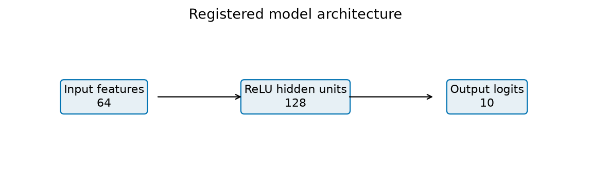

# Abstract

This report records a bounded research cycle executed through Codex. The registered primary comparison is pending; no confirmatory conclusion is available.

Recorded harness status: **running**; 3 operational phases accepted. Measurements below do not imply completion of unaccepted phases.

# Context, motivation, and introduction

Does AdamW weight decay improve held-out accuracy of a small MLP on the bundled digits data?

The objective is reproducible evidence and an inspectable research process. This study does not establish broad scientific reliability or superiority of an agent model.

# Background and method

- **analysis_kind**: "exploratory"
- **prior_results_known**: true
- **objective**: "Replicate a known fixed study to evaluate engineering completion; do not claim new scientific confirmation."
- **question**: "Does AdamW weight decay improve held-out accuracy of a small MLP on the bundled digits data?"
- **architecture**: [64, 128, 10]
- **optimizer**: "AdamW"
- **learning_rate**: 0.001
- **batch_size**: 64
- **epochs**: 50
- **methods**: ["regularized", "unregularized", "sensitivity", "shuffled_labels", "logistic", "class_prior"]
- **seeds**: [0, 1, 2]
- **data_boundaries**: "Frozen stratified 60/20/20 train/validation/test partition. Split seed 42. Divide pixels by the documented constant 16. Pilot reports validation only. No learned preprocessing or selection uses test data. Generalization is limited to this random example split, not new writers or datasets. Prior results on this evaluation set are known. All replication observations and conclusions are exploratory; no untouched-data claim is made."
- **analysis_plan**: "Use 10000 paired bootstrap resamples of test example indices with RNG seed 2026, preserving pairing across methods and all trained seeds. This interval conditions on the trained models and does not estimate training-population uncertainty. Separately show each seed effect and its sample standard deviation. Treat other comparisons as descriptive, with no post-hoc primary selection."
- **hyperparameter_rationale**: "Small prespecified network and fixed training budget provide fast feedback on an established task. The three decay values are a descriptive local sensitivity check, not a test-selected sweep. Three seeds expose limited initialization sensitivity; they do not support broad population claims."

*Research architecture.*

*Registered model architecture.*

# Results

| Method | Seed | Split | Accuracy | Seconds | Device |
|-------------------------|-----:|------------|-----------:|----------:|----------|
| regularized | 0 | validation | 0.966574 | 6.083 | cuda |

The registered primary comparison is pending; no confirmatory conclusion is available.

*All recorded accuracies.*

*Recorded learning curves.*

First saved test examples; no correctness-based selection: no applicable measurement recorded.

# Claims and evidence

Claims have not yet been distilled.

# Discussion, implications, and learnings

This is a preliminary artifact generated before final interpretation. All available outcomes are retained; a completed experiment is not evidence that the favored hypothesis is true.

# Limitations

- Conditional test-example intervals do not estimate variation over new training seeds, writers, or datasets.
- A small single-task study does not establish general model or harness superiority.

Exploratory outcomes do not become confirmatory by inclusion in this document. Missing metrics are not zero. Measurements without an applicable recorded objective are omitted; see the requirement checklist for explanations.

# Related work and sources

- [src-matplotlib-plot: Matplotlib Axes.plot API](https://matplotlib.org/stable/api/_as_gen/matplotlib.axes.Axes.plot.html)
- [src-python-unittest: Python 3.14 unittest: discovery, assertions and isolated fixtures](https://docs.python.org/3.14/library/unittest.html)
- [src-python-subprocess: Python 3.14 subprocess: argv sequences, pipes and process status](https://docs.python.org/3.14/library/subprocess.html)
- [src-adamw-paper: Decoupled Weight Decay Regularization — Loshchilov and Hutter, ICLR 2019](https://arxiv.org/abs/1711.05101)
- [src-adamw-code: AdamW-and-SGDW original implementation and license](https://github.com/loshchil/AdamW-and-SGDW)
- [src-torch-adamw: PyTorch AdamW API and algorithm, version 2.14](https://docs.pytorch.org/docs/2.14/generated/torch.optim.AdamW.html)
- [src-digits-loader: scikit-learn load_digits API](https://scikit-learn.org/stable/modules/generated/sklearn.datasets.load_digits.html)
- [src-uci-digits: Optical Recognition of Handwritten Digits — UCI, Alpaydin and Kaynak](https://archive.ics.uci.edu/dataset/80/optical+recognition+of+handwritten+digits)
- [src-splits: scikit-learn train_test_split API](https://scikit-learn.org/stable/modules/generated/sklearn.model_selection.train_test_split.html)
- [src-logistic: scikit-learn LogisticRegression API](https://scikit-learn.org/stable/modules/generated/sklearn.linear_model.LogisticRegression.html)
- [src-bootstrap: SciPy bootstrap API: paired resampling and interval definitions](https://docs.scipy.org/doc/scipy/reference/generated/scipy.stats.bootstrap.html)
- [src-reproducibility: PyTorch reproducibility notes, version 2.14](https://docs.pytorch.org/docs/2.14/notes/randomness.html)
- [src-nanda-process: How I Think About My Research Process: Explore, Understand, Distill — Neel Nanda](https://www.alignmentforum.org/posts/hjMy4ZxS5ogA9cTYK/how-i-think-about-my-research-process-explore-understand)
- [src-lones-pitfalls: How to avoid machine learning pitfalls: a guide for academic researchers — Michael A. Lones](https://arxiv.org/html/2108.02497v5)
- [src-prior-haiku: eureka-digits-haiku prior supplied-fixture execution](https://github.com/BurnyCoder/eureka-digits-haiku)
- [src-prior-luna: eureka-digits-luna prior supplied-fixture execution](https://github.com/BurnyCoder/eureka-digits-luna)
- [src-haiku-disclosure: Haiku historical cutoff and subsequent publication disclosure](https://github.com/BurnyCoder/eureka-digits-haiku/blob/main/reports/post-run-publication.md)
- [src-luna-disclosure: Luna post-publication provenance audit disclosure](https://github.com/BurnyCoder/eureka-digits-luna/blob/main/reports/post-run-publication.md)

# Conclusion

The registered primary comparison is pending; no confirmatory conclusion is available.

# Appendix: reproducibility and provenance

The committed protocol, per-experiment JSON files, saved predictions, loss histories, and checkpoints are the source of all numerical tables and figures. Rebuild using `eureka render`. See `docs/reproduction.md` for execution commands and environment details.

# AI statement

Codex wrote the harness and study fixture; Codex performed this cycle and drafted its interpretation. Any subsequent parent corrections are documented in the linked audit reports. The harness generated this paper from recorded artifacts. A human supplied the exact specification. Human cleanup and rewriting are in progress.
